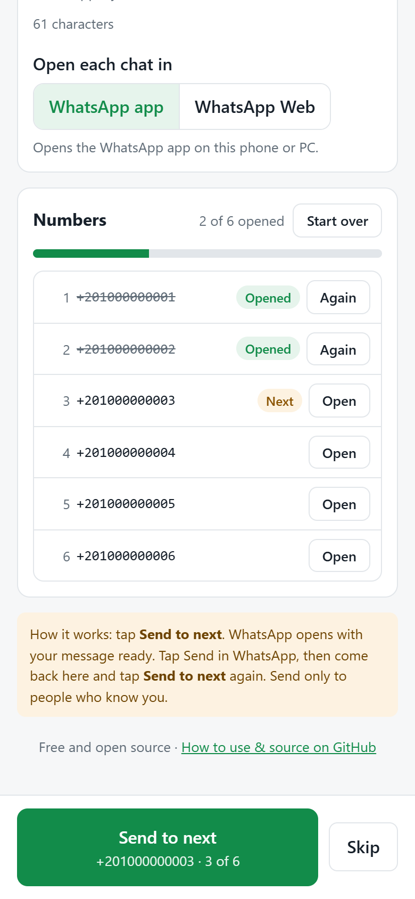
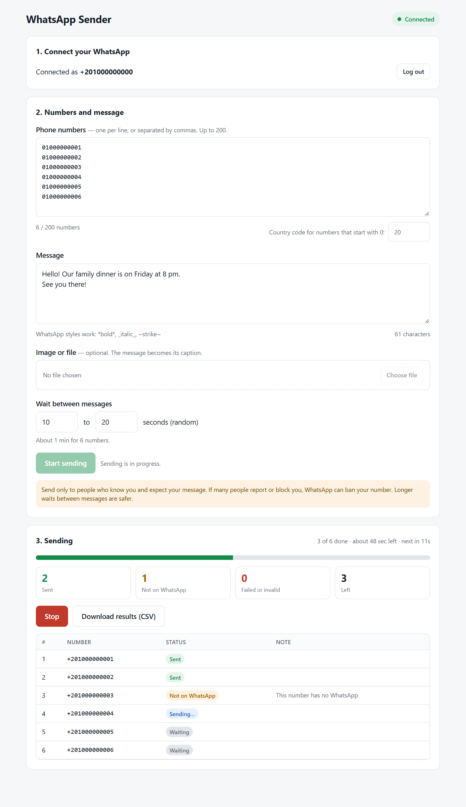

# WhatsApp Bulk Sender

Send one WhatsApp message to many numbers (up to 200). Each message is sent to each person separately, from **your own** WhatsApp.

**▶ Try it now:** https://ovastaapp.github.io/whatsapp-bulk-sender/

## Quick start

- **On a phone or computer, nothing to install:** open the link above, paste the numbers, write the message, and tap **Send to next** for each number.
- **Fully automatic from the link, on a computer:** install the free [helper extension](#make-it-fully-automatic-helper-extension) once in Chrome or Edge. Then click **Start automatic** and it sends to every number by itself.
- **Fully automatic on a Windows PC, with photos or files:** click **Code → Download ZIP**, unzip it, and double-click `start.bat`.

## Which version?

Pick the one that fits you:

| | **Tap to Send** (web page) | **Tap to Send + helper** (computer) | **Automatic Sender** (Windows app) |
|---|---|---|---|
| Where | Any phone or computer | Chrome or Edge on a computer | A Windows 10 or 11 PC |
| Install | Nothing | The helper extension, once | Node.js (`start.bat` helps you) |
| Sending | One tap per number, you press Send | **By itself**, every 10–20 s | **By itself**, every 10–20 s |
| Photo or file | No, text only | No, text only | Yes, one image or file |
| Start | Open the link | Open the link | Download this repo |

---

## 1. Tap to Send (web page)

**Open:** https://ovastaapp.github.io/whatsapp-bulk-sender/

<p align="center"></p>

### Get ready (computer or phone)
1. Open the link.
2. **Phone numbers:** paste your numbers, one per line or separated by commas.
   - Numbers that start with `0` get the country code added. The default is `20` (Egypt). Change the box if your numbers are from another country.
   - Numbers with `+` or `00` are used as they are.
   - Duplicates are removed by themselves.
3. **Message:** write your message. WhatsApp styles work: `*bold*`, `_italic_`, `~strike~`.

### On a computer
1. Under **Open each chat in**, choose:
   - **WhatsApp app** if you have the WhatsApp desktop app. Chats open in the app, with no extra tabs.
   - **WhatsApp Web** otherwise. Each chat opens in a WhatsApp Web tab. The first time, log in there with your phone (Linked devices → Link a device).
2. Click **Send to next**. The chat opens with your message ready.
3. Press **Enter** to send. With WhatsApp Web, close that tab after sending.
4. Come back to the page and click **Send to next** again. Repeat until it says **All done**.

> A website on its own can't open chats on a timer or press Send inside WhatsApp, because browsers don't let one site control another. For sending with no clicks, install the helper extension below.

### Make it fully automatic (helper extension)

The helper is a small, free browser extension for **Chrome or Edge on a computer**. With it, the Tap to Send page sends your message to every number **by itself**, through WhatsApp Web, waiting 10–20 seconds between messages. It shows **Sent**, **Not on WhatsApp** or **Failed** for each number.

**Install it (one time, about 2 minutes):**
1. On this page, click the green **Code** button, then **Download ZIP**.
2. Right-click the zip and choose **Extract All**. Remember where the folder is.
3. Open the extensions page:
   - **Chrome:** type `chrome://extensions` in the address bar and press Enter.
   - **Edge:** type `edge://extensions` in the address bar and press Enter.
4. Turn on **Developer mode** (top right in Chrome, left side in Edge).
5. Click **Load unpacked** and choose the **`extension`** folder inside the unzipped folder.
6. You should see **WhatsApp Bulk Sender Helper** in the list. Keep that folder; don't delete it.

**Use it:**
1. Open https://web.whatsapp.com once and log in with your phone (Linked devices → Link a device).
2. Open the [Tap to Send page](https://ovastaapp.github.io/whatsapp-bulk-sender/). Under **Open each chat in**, choose **WhatsApp Web**. You'll see **Automatic sending · Helper installed**. If the page was already open, reload it.
3. Paste the numbers and write the message. Set the wait between messages (default 10–20 seconds).
4. Click **Start automatic**. The helper uses your WhatsApp Web tab, or opens one, and sends to each number by itself.
5. Watch the list: **Sending…**, then **Sent**, **Not on WhatsApp** or **Failed**.
6. Click **Pause** any time and **Continue automatic** to go on. A message that is already going out finishes first, so nobody gets it twice.
7. When it says **All done**, click **Download results** to save the list as a CSV file.

**Good to know:**
- Keep both tabs open while it sends: the Tap to Send page and WhatsApp Web. Closing either one pauses it.
- If WhatsApp Web isn't logged in, the page asks you to scan the QR code, then click **Continue automatic**.
- WhatsApp sometimes changes WhatsApp Web. If messages start showing **Failed** with "Could not press Send", the helper needs an update.
- The helper only works with this page and WhatsApp Web. It doesn't read your chats or send anything anywhere else.

### On a phone: one tap per number
1. Under **Open each chat in**, choose **WhatsApp app** (it's already chosen on phones).
2. Tap **Send to next**. WhatsApp opens with your message ready.
3. Tap **Send** in WhatsApp.
4. Come back to the page and tap **Send to next** again. Repeat until it says **All done**.

### Extra buttons
- **Skip**: jump over the next number without opening it.
- **Open** / **Again**: open a chat for one number on the list.
- **Download results**: save the list with each number's status as a CSV file (opens in Excel).
- **Start over**: clear all results and begin again from the first number.

The page remembers your numbers, message and progress on your device, so you can close it and continue later. Nothing is sent to any server. Your list stays in your browser.

---

## 2. Automatic Sender (Windows app)

It sends to every number by itself, waiting 10–20 seconds between messages. You don't press anything after **Start sending**. You can attach one photo or file.

<p align="center"></p>

### Install (first time)
1. On this page, click the green **Code** button, then **Download ZIP**.
2. **Unzip it first:** right-click the zip and choose **Extract All**. Don't run it from inside the zip.
3. Open the unzipped folder and double-click **`start.bat`**.
   - If Node.js is missing, it asks to install it. Press **Y** and follow the steps, then double-click `start.bat` again.
   - The first start takes about a minute. It downloads what it needs.
4. Your browser opens the app at http://localhost:3000.

You need Google Chrome or Microsoft Edge. Edge comes with Windows.

### Connect your WhatsApp (first time only)
1. On your phone, open WhatsApp.
   - **iPhone:** Settings → Linked devices → Link a device
   - **Android:** ⋮ menu → Linked devices → Link a device
2. Scan the QR code on the page.
3. Wait until the badge at the top says **Connected**.

Next time you start the app, you won't need to scan again.

### Send messages
1. Double-click **`start.bat`**. Keep the black window open the whole time.
2. **Phone numbers:** paste up to 200, one per line or separated by commas. The same number rules as Tap to Send apply.
3. **Message:** write your message.
4. **Image or file** (optional): click **Choose file**, up to 30 MB. Your message becomes its caption.
5. **Wait between messages:** the default is a random 10–20 seconds. Longer waits are safer.
6. Click **Start sending** and confirm.
7. Watch each number's status:
   - **Sent**: the message went out.
   - **Not on WhatsApp**: the number has no WhatsApp account.
   - **Failed** or **Invalid**: something went wrong, or the number isn't valid.
8. When it's done, click **Download results (CSV)** to save the list. It opens in Excel.

You can click **Stop** at any time.

### Log out
Click **Log out** on the page. This unlinks your WhatsApp from this PC.

### If something goes wrong
| Problem | What to do |
|---|---|
| `start.bat` says "opened from inside the zip" | Unzip the folder first, then run `start.bat` from the unzipped folder. |
| The page says "App closed — start it again" | The black window was closed. Double-click `start.bat` again. |
| The QR code doesn't appear after a minute | Check your internet, close the black window, and start again. |
| Port 3000 is busy | Close other copies of the app, or set a different `PORT` (see below). |

---

## Please read: stay safe
- Messages go out from **your own** WhatsApp number.
- **Send only to people who know you** and expect your message. If many people block or report you, WhatsApp can ban your number.
- The Automatic Sender controls WhatsApp Web. It is **not an official WhatsApp tool**, so use long waits and small lists.
- Tap to Send on its own only opens normal WhatsApp chats, so you press Send yourself every time.
- The helper extension and the Automatic Sender send by themselves. That is automatic sending, so the same ban risk applies: keep the waits long, the lists small, and send only to people who know you.

---

## For developers

### Project files
```
docs/index.html       Tap to Send page (served by GitHub Pages from /docs)
docs/images/          Screenshots used in this README (made-up numbers)
extension/            Helper extension (Chrome/Edge, Manifest V3)
  background.js         runs the send queue: one WhatsApp Web tab, random wait between messages
  page-bridge.js        connects the Tap to Send page with the extension
  whatsapp.js           on web.whatsapp.com: presses Send, reports Sent / Not on WhatsApp / Failed
server.js             Automatic Sender: web server + WhatsApp connection
public/index.html     Automatic Sender: the page you use at localhost:3000
start.bat             Windows launcher (checks Node.js, installs, starts)
START HERE.txt        Short steps for people who download the app
package.json          Node.js dependencies (express, multer, qrcode, whatsapp-web.js)
```

### Run from a terminal
```
npm install
npm start
```

### Settings (environment variables)
| Variable | What it does | Default |
|---|---|---|
| `PORT` | Port for the local page | `3000` |
| `CHROME_PATH` | Path to Chrome or Edge, if it's in an unusual place | found automatically |
| `SESSION_DIR` | Where the WhatsApp login is saved | `C:\Users\<you>\.wa-sender` |
| `NO_OPEN` | Set to `1` to not open the browser at start | not set |

### Notes
- The WhatsApp login is saved outside the project folder on purpose: deep Windows paths break Chrome's saved WhatsApp data.
- The app only listens on `127.0.0.1`, so other devices on your network can't open it.
- To update the Tap to Send page, edit `docs/index.html` and push to `main`. GitHub Pages updates the link within a minute.
